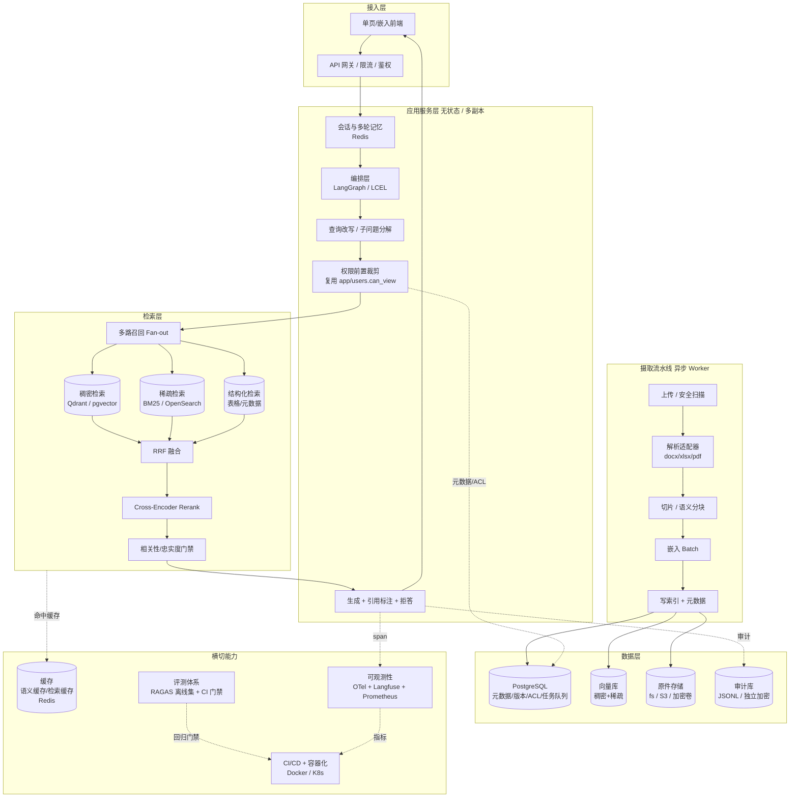
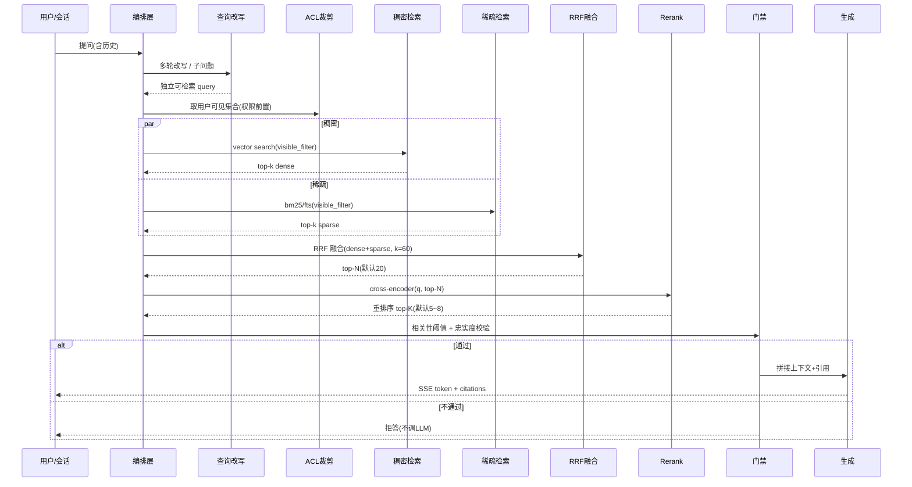
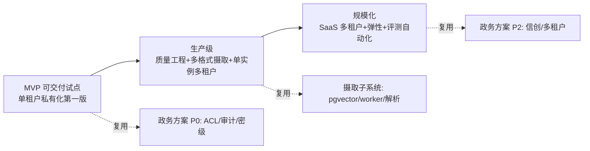

# 生产级 RAG 架构演进分析（技术深改侧）

| 项 | 内容 |
|---|---|
| 文档定位 | 技术深改侧分析，面向"产品交付前优化 / 可售卖化" |
| 基线代码 | `D:\dev\rag`（LangChain 教学主线 `main.py` + 政务试点 `app/`） |
| 已有前置文档 | [`政府级RAG改造方案.md`](政府级RAG改造方案.md)（政务私有化：ACL/审计/密级/拒答）、[`文档摄取子系统设计.md`](文档摄取子系统设计.md)（摄取流水线：pgvector/worker/解析器/表头识别） |
| 本文关系 | **互补而非重复**：本文把系统放到"可售卖产品"视角，补齐前两文明确延后或缺失的维度——检索质量深化、多租户 SaaS、向量库规模化选型、可观测性、评测自动化、CI/CD、容器化、成本与性能建模、水平扩展。政务私有化的合规/权限/摄取结论本文直接复用，不重写。 |
| 假设定位 | 面向「中小企业 / 政务」的知识库问答，交付形态为 **SaaS 多租户 + 私有化单机/单集群** 两种并行。若实际只做其一，见文末「待明确事项」。 |
| 语言 | 中文 |

---

## 0. 一句话判断

当前系统是**正确的教学原型 + 可用的政务试点骨架**，但离"可售卖"还差一条主线：

> **从"单进程、本地、内存态、无评测"走向"无状态服务 + 异步流水线 + 多租户隔离 + 可观测可评测 + 可水平扩展"。**

前两文已经把**政务合规与文档摄取**这两块最难、最重的地基设计好了。本文补的是**让这套地基能被当作产品反复交付、规模化运维、持续验证质量**的那一层工程架构。下述所有建议都以"不推翻 `main.py` 教学主线、不重写 `app/` 政务原型已验证的权限/审计逻辑"为前提。

---

## 1. 生产级 RAG 总体架构

### 1.1 组件图（分层 + 数据流）



### 1.2 分层职责与边界（关键接口示意）

| 层 | 职责 | 对外关键接口（示意，非实现） | 不负责 |
|---|---|---|---|
| 接入层 | 鉴权、限流、SSE 流式 | `POST /v1/chat`, `POST /v1/documents` | 检索、解析 |
| 编排层 | 串联 改写→ACL→召回→融合→Rerank→门禁→生成 | `async def run_qa(req: QARequest) -> AsyncIterable[QAEvent]` | 具体召回算法 |
| 检索层 | 多路召回、融合、精排、门禁 | `retrieve(user, q) -> RankedChunks`；`rerank(q, chunks) -> ScoredChunks` | 文档解析 |
| 摄取层 | 异步解析/切片/嵌入/建索引 | `enqueue(job)`；`IngestWorker.run()` | HTTP、会话 |
| 数据层 | 元数据/向量/原件/审计持久化 | SQL + 向量查询 DSL | 业务规则 |
| 横切 | 缓存/观测/评测/发布 | `Cache.get/set`、`trace.span`、`eval.run` | — |

> **复用边界**：`app/users.can_view`、`app/rag_service` 的权限前置与拒答逻辑、摄取子系统设计的 `ingest/`（pgvector/worker/解析器）均原样长入新架构；新增的仅是编排、Rerank、缓存、观测、评测、容器化与多租户隔离外壳。

---

## 2. 检索质量深化

### 2.1 多路召回 + 融合 + 精排（核心链路）



### 2.2 Rerank（精排）—— 当前最大短板

现状只有 RRF 融合、无相关性精排，Top-5 里常混着"沾边但不答"的片段。补一道 cross-encoder：

| 方案 | 实现 | 时延 | 成本 | 离线私有化 | 推荐度 |
|---|---|---|---|---|---|
| **本地 Cross-Encoder** | `bge-reranker-v2-m3`（1024 维，与 bge-m3 对齐）经 **Ollama** 或 **Infinity**（`bettertransformer`/ONNX）批量服务 | top-20 约 30–80ms | 本地免费 | ✅ 完全离线 | **首选** |
| 在线 Rerank API | Cohere `rerank` / Jina `rerank` | 几十 ms | 按调用计费 | ❌ 政务禁用 | SaaS 可选 |
| LLM-as-Judge 排序 | 让大模型打分 | 数百 ms~秒级 | 高 | 视模型 | ❌ 仅离线评测，不进在线 |

**工程落点**：在 `app/rag_service.retrieve` 的 RRF 之后插入 `Reranker.rerank(query, chunks)`，默认只精排融合后的 top-20 → 取 top-5/8。阈值用离线评测集校准（替换现 `RAG_MAX_DISTANCE` 的"单看距离"判定，改为"Rerank 分数 + 距离"双判）。

### 2.3 召回策略优化

| 手段 | 说明 | 与现状关系 |
|---|---|---|
| **多路召回 Fan-out** | 稠密 + 稀疏 + 结构化（表格/元数据 SQL）并行，RRF 融合 | 现状已有稠密+稀疏，补"结构化一路"（政务表格问答 P2 前可先用元数据过滤） |
| **查询改写/子问题** | 现状 `condense_question` 仅做追问还原；升级为"分解+扩展同义词"（中文可用词典+bge 做 query 扩写） | 复用并增强 `core.condense_question` |
| **元数据过滤前置** | 把 `dept/classification/tenant_id/doc_type` 下推到向量库 payload / SQL WHERE，而非先取后筛 | 现状 FAISS `filter` 回调 + BM25 裁剪已对，规模化后必须落到 DB 层 |
| **混合距离度量** | 迁移到余弦相似度（与 bge-m3 训练一致），重测阈值 | 现状 L2 仅因教学便利，生产应切 cosine |

### 2.4 Chunk 策略优化

现状：`RecursiveCharacterTextSplitter`（固定 400 字）。问题：硬切切断语义、标题上下文丢失、长文档首尾弱。

| 策略 | 适用 | 说明 |
|---|---|---|
| **标题感知分块**（现状已有雏形） | 全部 | 切片前缀带 `《标题》> 一级 > 二级`，摄取子系统已设计 |
| **父子分块 / small-to-big** | 全部 | 检索用细粒度小块（命中准），生成时回取父块（上下文全），提升 Recall 且降噪 |
| **语义分块** | 长文档 | 用句向量断点切，而非固定字数；可用 `semantic-chunking` 思路 |
| **Late Chunking** | 超长文档 | 先对整个文档做 embedding 再按窗口切，保留全局上下文，缓解长尾遗忘 |
| **上下文富化** | 全部 | 每个块附"本块摘要/所属节/关键实体"，提升 Rerank 与生成质量 |

> 不建议一上来全上。优先级：**父子分块 > 标题感知 > 语义分块**；Late Chunking 仅长文档场景启用。

---

## 3. 可扩展性与工程化

### 3.1 多租户隔离

| 隔离级别 | 做法 | 适用 | 成本/运维 |
|---|---|---|---|
| **独立部署**（现状政务思路） | 每客户一套容器/集群，物理隔离 | 政务、大客户、强合规 | 高，但最稳 |
| **Schema-per-tenant** | 单实例多 schema，DB 层隔离 | 中大型租户 | 中 |
| **Row-level `tenant_id`** | 所有表/向量带 `tenant_id`，查询强制过滤 | 中小 SaaS 默认 | 低，需防越权（所有查询必须带 filter） |
| **共享向量库 + 查询过滤** | 向量库 payload 带 tenant，召回即过滤 | SaaS 规模化 | 低，依赖向量库 payload 过滤能力 |

**推荐演进**：SaaS 默认走 **Row-level `tenant_id` + 向量库 payload 过滤**（零额外运维）；政务/大客户走 **独立部署**（复用现有离线私有化设计）。ACL 裁剪逻辑在 `tenant_id` 之上再叠加 `dept/classification`，形成两级过滤。

### 3.2 向量库选型（FAISS → ?）

| 维度 | FAISS（现状） | pgvector | Qdrant | Milvus |
|---|---|---|---|---|
| 部署形态 | 本地文件，单进程 | PG 扩展，随 PG 起 | 独立服务 | 独立分布式 |
| 增量/删除 | 重建或手工 ID 映射 | `UPDATE/DELETE` | 原生点写 | 原生 |
| 并发写 | ❌ 写时不可查 | ✅ MVCC | ✅ | ✅ |
| 元数据/ACL 过滤 | 回调后筛 | SQL WHERE 前置 | **payload filter 强** | 强 |
| 水平扩展 | ❌ | 读副本/分库 | **分片+副本** | **天然分布式** |
| 运维复杂度 | 低 | 低（复用 PG） | 中 | 高 |
| 适用规模 | 万级切片 | 百万级（摄取子系统已选） | **千万级、SaaS** | 亿级 |
| 离线私有化 | ✅ | ✅ | ✅ | ✅ |

**工程判断**：
- **P0/P1（私有化、百万切片以内）**：沿用摄取子系统选定的 **PostgreSQL + pgvector**，好处是 ACL/版本/任务队列/元数据全在一库，运维只有一个组件，且与已有设计完全一致。
- **P2（SaaS 规模化、跨租户高并发）**：引入 **Qdrant** 作为向量专库，用 payload filter 做 `tenant_id + classification + dept` 前置过滤，PG 退为元数据/事务源。Qdrant 的量化（scalar/产品量化）可把内存压到 1/4，适合多租户高密度。
- **Milvus** 仅在单租户语料冲到 **亿级** 或需要极致吞吐时考虑，运维代价高，不进默认路线。
- 抽象一个 `VectorStore` 接口（`search/upsert/delete/filter`），后端可在 `pgvector ↔ qdrant` 间切换，不影响检索层。

### 3.3 异步任务与文档解析流水线

现状：FastAPI 单进程，首请求同步建索引，上传会阻塞问答。

- **解耦**：接入"异步摄取"——上传即返回 202，Worker 后台跑 解析→切片→嵌入→建索引→激活（摄取子系统状态机已设计）。
- **队列选型**：
  - 私有化/无额外组件：沿用摄取子系统的 **PG `SELECT … FOR UPDATE SKIP LOCKED`** 队列（少一个 Redis 依赖）。
  - SaaS/高吞吐：换 **arq（基于 Redis，async 原生）** 或 **Celery**；需要长时可靠工作流（跨多步、可观测、重试/回滚）可上 **Temporal**。
- **幂等 + 版本**：内容 hash 去重、切片 hash 去重、原子激活（摄取子系统已定义），原样复用。
- **GPU 隔离**：embedding/rerank 只在 Worker 侧调用，问答请求只查库，避免争抢（现状已原则性约定，规模化必须硬性隔离）。

### 3.4 缓存（降本 + 降时延的关键）

| 缓存层 | 内容 | 命中效果 |
|---|---|---|
| **语义缓存**（答案） | 按 query embedding 近邻命中的历史答案（如 GPTCache / 自建） | 直接返回，省一次 LLM + 检索；对高频重复问法收益最大 |
| **检索缓存** | (user_scope, query) → top-K chunks | 省多路召回 + Rerank |
| **Embedding 缓存** | 文本 → 向量（摄取与查询共享） | 省重复嵌入 |
| **精确配置缓存** | 阈值/模型版本/租户配置 | 省 DB 读 |

> 语义缓存**必须带 scope 隔离**（不同 tenant / 不同密级可见范围不串缓存），否则等于跨租户泄露。Cache key 用 `tenant_id + acl_signature + query_embedding`。

### 3.5 水平扩展

| 组件 | 扩展方式 |
|---|---|
| API/编排层 | **无状态**，多副本（uvicorn/gunicorn workers 或 K8s HPA），会话/历史放 Redis |
| 检索层 | 向量库与 PG 独立部署；Qdrant 分片、PG 读副本 |
| 摄取层 | Worker 水平加节点（`INGEST_WORKERS` 提升），队列削峰 |
| LLM | 经**统一 LLM 网关**做限流/熔断/重试/多 provider 路由（本地 Ollama ↔ DeepSeek ↔ 其他） |
| 连接 | `pgbouncer` 连接池；向量库连接池 |
| 队列满 | 返回 429，拒绝新上传（摄取子系统已设计） |

---

## 4. 质量保障

### 4.1 RAG 评估体系

现状：仅 46/73 个 pytest 测**代码正确性**，无 RAG **效果**评测。这是"能否卖出去"的硬伤——没有评测就无法证明效果、无法防回归。

| 层 | 手段 | 指标 | 触发 |
|---|---|---|---|
| 离线评测集 | 自建 JSONL（问题 / 标准答案 / 应命中 doc_id / 应拒答标记）+ **RAGAS** | `faithfulness`（忠实度）、`answer_relevancy`、`context_precision`、`context_recall`；自加 `拒答准确率`、`引用准确率`、`Recall@5` | 每次换模型/提示词/切分/embedding |
| 在线抽样 | **Langfuse** 轨迹采样 + LLM-as-judge | 用户满意度、幻觉率 | 持续 |
| 注入安全 | 10+ 条间接提示注入样本 | 模型不得执行文档内指令 | CI + 定期 |

**评测集规模建议（可售卖门槛）**：P0 ≥100 问（政务语料可扩充），P1 ≥500 问，P2 ≥2000 问含长尾。

**回归门禁**：指标下降 >3% 阻断发布（政务方案已定，本文落到 CI）。

### 4.2 可观测性

| 能力 | 选型 | 说明 |
|---|---|---|
| 链路追踪 | **OpenTelemetry** + **Langfuse**（自托管，GDPR 友好，政务可用） | 覆盖 改写→召回→Rerank→生成 全 span，定位慢环节 |
| 日志 | 结构化 JSON 日志（租户/请求 ID/耗时/命中） | 审计与排障统一 |
| 指标 | **Prometheus** + **Grafana** | 首响时延、检索时延、Rerank 时延、LLM TTFT、并发、成本/请求、拒答率、缓存命中率 |
| 告警 | Grafana Alert / Webhook | 时延突增、错误率、成本超阈值、队列积压 |

> 政务场景优先 **Langfuse 自托管**（数据不出内网）；SaaS 可用 LangSmith 云或同样自托管。

### 4.3 CI/CD

```
代码提交 → lint(ruff) → 类型(mypy) → 单测(pytest) → 评测门禁(RAGAS 离线集)
        → 构建镜像(Docker 多阶段) → 部署预发 → 冒烟 → 生产(蓝绿/灰度)
```

- 评测门禁失败即红，禁止合并/发布。
- 镜像版本与 `评测报告` 绑定，可回溯。

### 4.4 容器化部署

| 形态 | 内容 | 适用 |
|---|---|---|
| `Dockerfile`（多阶段） | 依赖锁定（uv）、非 root、体积精简 | 所有形态基础 |
| `docker-compose` | 单节点：app + worker + PG(pgvector) + Redis + Langfuse | 私有化单机/演示 |
| `Helm` / K8s | 无状态副本 + Worker 部署 + Qdrant/PG StatefulSet + HPA | SaaS / 规模化 |
| 离线镜像 | 模型/OCR/LibreOffice 全打进镜像，运行时不外联 | 政务（已有离线约束） |

---

## 5. 成本与性能

### 5.1 成本模型

| 环节 | 本地(Ollama) | 在线(DeepSeek 等) | 备注 |
|---|---|---|---|
| Embedding | 免费（需本地算力） | 不提供，仍本地 | 只在 Worker 侧批量跑 |
| Rerank | 免费（bge-reranker 本地） | 按次计费 | 本地首选 |
| LLM 生成 | 免费（需 GPU/内存） | `deepseek-chat` ≈ $0.14/1M in、$0.28/1M out | 政务默认本地；SaaS 可在线 |
| 向量库 | 自托管 | 可有托管 | Qdrant Cloud / pgvector 托管 |
| **缓存收益** | 语义缓存命中率每 +10%，LLM 调用约 -10% | 同左 | **最大降本杠杆** |

**结论**：私有化靠"本地模型 + 缓存"把边际成本压到近零；SaaS 靠"在线 LLM + 语义缓存 + 小上下文"控制 token 成本。Rerank/embedding 一律本地，不引入额外计费项。

### 5.2 首响时延（TTFT）拆解

| 阶段 | 量级 | 优化 |
|---|---|---|
| 改写 | 100–400ms | 可并行/缓存改写结果 |
| 多路召回 | 20–60ms（向量+BM25） | 并行 fan-out、索引优化 |
| Rerank(top-20) | 30–80ms | 本地 batch、只精排融合后 top-N |
| LLM TTFT | 本地 1.5B 快但弱；DeepSeek ≈ 300–800ms | 流式输出先发首 token、小上下文、网关重试 |
| **总首响（有缓存）** | 可压到 **<300ms** | 语义缓存命中直接返回 |
| **总首响（无缓存）** | 1–2s 级 | 流式缓解体感 |

### 5.3 并发

- API 无状态 + 多副本 → 并发随副本线性增。
- 瓶颈通常在 **LLM 网关**（限流/并发配额）与 **embedding 批量**（已隔离到 Worker）。
- 用 pgbouncer + 向量库连接池防连接风暴；队列满 429 削峰。

---

## 6. 关键模块 / 文件结构建议

在现有 `main.py`（教学）+ `app/`（政务原型）+ `ingest/`（摄取子系统）之上，长出"产品化外壳"，不推翻已有代码：

```
src/                        # 新增：产品化包（原 app/ 逐步迁入或并置）
├── api/                    # 接入层：FastAPI 路由、鉴权、限流、SSE
│   ├── routes_chat.py
│   ├── routes_documents.py
│   ├── auth.py             # OIDC/SSO(SaaS) 或 演示会话(私有化)
│   └── deps.py             # tenant/session 注入
├── orchestration/          # 编排层
│   ├── graph.py            # LangGraph / LCEL 编排（改写→ACL→召回→Rerank→生成）
│   └── state.py
├── retrieval/              # 检索层（从 app/rag_service 演进）
│   ├── retriever.py        # 多路召回 fan-out
│   ├── fusion.py           # RRF
│   ├── reranker.py         # Cross-Encoder 接口 + Ollama/Infinity 适配
│   └── gate.py             # 相关性 + 忠实度门禁
├── generation/             # 生成层
│   ├── llm_gateway.py      # 多 provider 路由/限流/熔断
│   └── prompts.py
├── tenancy/                # 多租户
│   ├── context.py          # tenant_id / acl_signature
│   └── isolation.py        # 行级/向量 payload 过滤
├── cache/                  # 缓存
│   ├── semantic.py         # 语义答案缓存（带 scope 隔离）
│   └── retrieval_cache.py
├── observability/          # 可观测性
│   ├── tracing.py          # OTel + Langfuse
│   └── metrics.py          # Prometheus
├── evaluation/             # 评测
│   ├── dataset.py          # 离线集加载
│   ├── ragas_eval.py       # RAGAS 指标
│   └── gate.py             # CI 门禁
├── ingestion/              # 复用 docs/文档摄取子系统设计.md 的 ingest/
├── models/                 # 共享数据模型 / pydantic
└── config.py               # pydantic-settings 全局配置

infra/
├── Dockerfile              # 多阶段
├── docker-compose.yml      # 私有化单节点
├── helm/                   # SaaS K8s
└── postgres/init.sql       # pgvector 扩展 + schema

evals/
├── gov_100.jsonl           # 离线评测集（≥100）
└── injection_10.jsonl      # 注入安全样本

docs/
├── 政府级RAG改造方案.md     # 已有
├── 文档摄取子系统设计.md     # 已有
└── 生产级RAG架构演进分析.md  # 本文

tests/                      # 已有 + 新增编排/检索/评测/隔离测试
main.py                     # 教学主线（不动）
app/                       # 政务原型（验证过的 ACL/审计，逐步外移到 src/）
ingest/                    # 摄取子系统（按已设计方案实现）
```

**迁移原则**：`RETRIEVAL_BACKEND=pg|faiss|qdrant` 开关；`app/rag_service` 的 ACL/拒答逻辑上移到 `src/retrieval` + `src/tenancy`；教学 `main.py` 与 `faiss_index/` 永不改动。

---

## 7. 依赖包增量列表

```
# 编排与检索
langgraph>=0.2                 # 多步有状态编排（改写/子问题/自反思）
# 向量库（按阶段）
pgvector>=0.3                 # P0/P1 沿用摄取子系统选型
qdrant-client>=1.12            # P2 SaaS 规模化
# Rerank / 嵌入服务
infinity-client>=0.6          # 本地 cross-encoder/embedding 批服务（可选，替代逐条 Ollama）
# 缓存
redis>=5.0                    # 会话/语义缓存/arq 底座
arq>=0.26                     # async 任务队列（SaaS 高吞吐；私有化可继续用 PG 队列）
# 多租户与鉴权
pydantic-settings>=2.0        # 全局配置
authlib>=1.3                  # OIDC/SSO（SaaS）；私有化接内部统一身份
fastapi-users>=13 OR 自建     # SaaS 用户体系
# 可观测性
opentelemetry-sdk>=1.27
opentelemetry-exporter-otlp>=1.27
langfuse>=2.0                 # 自托管轨迹/评测
prometheus-client>=0.20
# 评测
ragas>=0.2                    # RAG 效果指标
datasets>=3.0                 # 评测集管理
deepeval>=0.21                # RAGAS 替代/补充
# 工程化
ruff>=0.7                     # lint
mypy>=1.13                    # 类型
pytest>=9.0                   # 已有
pytest-asyncio>=0.24          # 异步测试
httpx>=0.28                   # 已有，网关/测试用
# 容器/部署（非 Python 依赖，列于此供参考）
# Docker / docker-compose / Helm / pgbouncer / Langfuse-server
```

> 私有化形态可**不引入** redis/arq/qdrant/langfuse-cloud，用 PG 队列 + 本地 Langfuse + 内存/文件缓存替代，保持"单组件、可离线"。上述增量按交付形态裁剪。

---

## 8. 分期路线（MVP → 生产级 → 规模化）



| 阶段 | 技术目标（可执行） | 复用/新增 | 验收信号 |
|---|---|---|---|
| **阶段一 · MVP（可交付试点）** | ① 权限前置 + 审计 + 拒答落地（政务方案 P0）② RRF 后加 **Cross-Encoder Rerank** ③ 距离切 cosine + 双判门禁 ④ 建 **≥100 问离线评测集** + 手动评测 ⑤ **Docker 单节点**容器化，离线可跑 ⑥ 父子分块试点 | 复用 `app/` 政务原型、摄取子系统的 ACL/拒答思想 | 政务语料越权零泄露；Recall@5/拒答准确率有基线数字；单机 `docker compose up` 即可演示 |
| **阶段二 · 生产级** | ① **异步摄取流水线**全格式（摄取子系统 P0）② **可观测性**：OTel+Langfuse+Prometheus 全链路 ③ **语义缓存 + 检索缓存**（scope 隔离）④ **CI/CD 含 RAGAS 评测门禁**，评测集 ≥500 ⑤ **单实例多租户**（row-level `tenant_id` + 向量 payload 过滤）⑥ 无状态 + Worker 水平扩展 ⑦ 成本/时延看板 | 复用摄取子系统、新增编排/Rerank/缓存/观测/评测/CI | 换模型/切分参数 CI 自动拦回归；缓存命中率>20% 后成本可见下降；多租户数据不串 |
| **阶段三 · 规模化** | ① **SaaS 多租户**（独立部署 / schema 隔离 / row-level 三档）② 向量库切 **Qdrant** 分片 + 量化 ③ **自动扩缩容**（K8s HPA）④ 评测自动化 + 在线质量采样闭环 ⑤ 模型路由/小模型降本 ⑥ 信创适配（政务方案 P2）⑦ 容量规划（千万~亿级切片） | 复用前两文 P2，新增 Qdrant/弹性/路由 | 单租户故障不波及他租户；峰值自动扩容；评测集 ≥2000 且持续回归绿 |

> 与前两文分期映射：阶段一 ≈ 政务方案 P0 + 检索深化基础；阶段二 ≈ 政务方案 P1 + 摄取子系统 + 质量工程；阶段三 ≈ 政务方案 P2 + SaaS 规模化。本文把"评测/观测/缓存/容器化/多租户 SaaS"这些前两文未展开的维度补齐进对应阶段。

---

## 9. 待明确事项（需产品/主理人裁决）

1. **交付形态优先级**：SaaS 多租户、私有化单机、还是两者并行？决定向量库选型（pgvector vs Qdrant）与多租户隔离级别。
2. **目标客群与合规门槛**：政务是否必须等保/密评？中小企业是否需数据出境合规？影响在线 LLM 是否可用（政务默认离线）。
3. **规模预期**：单租户文档量（万/百万/亿）、租户数、峰值 QPS？决定向量库与扩缩容方案。
4. **预算与算力**：是否接受本地 GPU（embedding/rerank/LLM 全本地）还是必须在线 LLM？直接决定成本结构与私有化可行性。
5. **在线模型策略**：SaaS 能否用 DeepSeek/Cohere/Jina？政务是否彻底禁用外联（已有离线约束）？
6. **embedding/rerank 模型策略**：是否锁定 bge-m3 / bge-reranker-v2-m3，还是需支持客户自带模型？
7. **多语言需求**：是否仅中文，还是需中英混合（影响分词与模型选型）？
8. **SLA 要求**：首响时延、可用性（几个 9）、数据留存时长？决定缓存/副本/备份投入。
9. **计费模式**：私有化按授权/实施费，SaaS 按席位/文档量/token？影响语义缓存与成本看板的设计权重。
10. **是否纳入前两文未覆盖的数据源**：网页/邮件/PPT/数据库（Text-to-SQL）是否在产品范围内？

---

## 10. 关键工程判断（给主理人/工程师的"可执行结论"）

1. **不要推翻已有设计**：`main.py` 教学线不动；政务 `app/` 的 ACL/审计与摄取子系统设计是两座已打好的地基，本文全部复用。
2. **检索质量第一刀 = Rerank**：本地 `bge-reranker-v2-m3`，成本零、时延可忽略、效果提升最显著。
3. **向量库分两步走**：P0/P1 用 pgvector（与摄取子系统一致、运维最少）；P2 SaaS 才上 Qdrant。
4. **评测是售卖前提**：没有 RAGAS 离线集 + CI 门禁，"效果"无法证明也无法防回归——这是从原型到产品的最大鸿沟。
5. **缓存是降本第一杠杆**：语义缓存带 scope 隔离，命中率每 +10% 约等于 LLM 成本 -10%。
6. **无状态 + 异步**是水平扩展的不二法：API 无状态、摄取异步、LLM 走网关。
7. **多租户用 row-level `tenant_id` 起步**，政务/大客户用独立部署；两级过滤 = `tenant_id` + `dept/classification`。
8. **可观测性用自托管 Langfuse + OTel**，政务数据不出内网。
